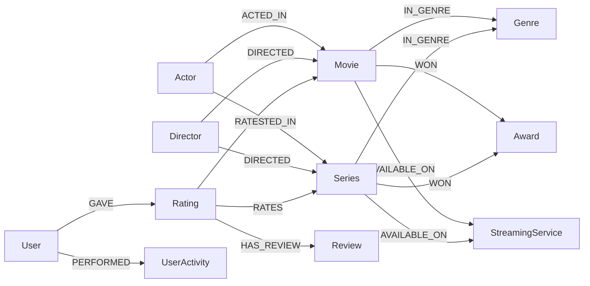

# Database-mapping: MySQL → MongoDB og Neo4j

Kilder:

- **MySQL:** `rotten_potatoes_full_dump.sql` (Mandatory 1), 22 tabeller og 2 views.
- **MongoDB:** eksisterende design i `database/mongodb/design/*.json` (eksporteret fra databasen `RottenPotatoes`).
- **Neo4j:** eksisterende design i `database/neo4j/design/constraints.cypher` (eksporteret fra databasen `rottenpotatoes`). Designet indeholder kun labels og id-constraints.

Markeringer:

- **TODO:** beslutning mangler i jeres design.
- **Ikke i design:** MySQL-data, som designet ikke har med. Det kan være et bevidst fravalg; skriv begrundelsen.

---

## 1. MySQL-tabeller

| Tabel | Kolonner | Nøgler / relationer |
|---|---|---|
| Movies | Id, Title, Duration, ReleaseDate, Resume, Language, AgeRating, CreatedAt, UpdatedAt, AverageRating | PK Id |
| Series | Id, Title, ReleaseDate, Resume, Language, AgeRating, Seasons, Episodes, CreatedAt, UpdatedAt | PK Id |
| Actors | Id, Name, DateOfBirth, Biography | PK Id |
| Directors | Id, Name, DateOfBirth, Biography | PK Id |
| Genres | Id, Name | PK Id, UQ Name |
| Awards | Id, Name | PK Id, UQ Name |
| StreamingServices | Id, Name | PK Id, UQ Name |
| Users | Id, Username, Email, PasswordHash, CreatedAt, UpdatedAt | PK Id, UQ Username, UQ Email |
| Ratings | Id, UserId, MovieId, SeriesId, Score, CreatedAt, UpdatedAt | FK Users, Movies, Series. Præcis én af MovieId/SeriesId |
| Reviews | Id, RatingId, Content, CreatedAt, UpdatedAt | FK Ratings (1:1, UQ RatingId) |
| UserActivity | Id, UserId, ActivityType, ActivityAt | FK Users |
| UserActivityArchive | Id, UserId, ActivityType, ActivityAt, ArchivedAt | ingen FK (fyldes af eventet ArchiveOldUserActivity) |
| MovieActors / SeriesActors | MovieId/SeriesId, ActorId | junction (M:N) |
| MovieDirectors / SeriesDirectors | MovieId/SeriesId, DirectorId | junction (M:N) |
| MovieGenres / SeriesGenres | MovieId/SeriesId, GenreId | junction (M:N) |
| MovieAwards / SeriesAwards | MovieId/SeriesId, AwardId | junction (M:N) |
| MovieStreamingServices / SeriesStreamingServices | MovieId/SeriesId, StreamingServiceId | junction (M:N) |

Views (afledte data, migreres normalt ikke): `MovieRatingOverview`, `SeriesRatingOverview`.

---

## 2. MongoDB-collections

Implementeret i `src/RottenPotatoes.Migrator` (`MongoMigrationService`, `Mappings/MongoMappings.cs`, `Models/Mongo/`).
Id'er gemmes som int32, decimaler som Decimal128 og datoer som UTC.
**Migreret** markerer de beslutninger, migratoren har taget. Er I uenige, så ret både migratoren og dette dokument.

### movies

| Dokumentfelt | Type | MySQL-kilde |
|---|---|---|
| `_id` | int | Movies.Id |
| `title` | string | Movies.Title |
| `duration` | int | Movies.Duration |
| `releaseDate` | date | Movies.ReleaseDate |
| `resume` | string | Movies.Resume |
| `language` | string | Movies.Language |
| `ageRating` | string | Movies.AgeRating |
| `averageRating` | decimal | **Migreret:** beregnet som AVG(Ratings.Score), afrundet til 2 decimaler. Movies.AverageRating bruges ikke, fordi den er 0.00 for alle film i testdataene (triggeren kører kun ved nye ratings) |
| `createdAt` | date | Movies.CreatedAt |
| `updatedAt` | date | Movies.UpdatedAt |
| `genres[]` {id, name} | embedded | MovieGenres ⋈ Genres |
| `actors[]` {id, name, dateOfBirth, biography} | embedded | MovieActors ⋈ Actors |
| `directors[]` {id, name, dateOfBirth, biography} | embedded | MovieDirectors ⋈ Directors |
| `awards[]` {id, name} | embedded | MovieAwards ⋈ Awards |
| `streamingServices[]` {id, name} | embedded | MovieStreamingServices ⋈ StreamingServices |

### series

| Dokumentfelt | Type | MySQL-kilde |
|---|---|---|
| `_id` | int | Series.Id |
| `title`, `releaseDate`, `resume`, `language`, `ageRating` | | Series.Title, ReleaseDate, Resume, Language, AgeRating |
| `averageRating` | decimal | **Migreret:** beregnet som AVG(Ratings.Score), afrundet til 2 decimaler (samme værdi som `SeriesRatingOverview`). 0 hvis ingen ratings |
| `createdAt`, `updatedAt` | date | Series.CreatedAt, UpdatedAt |
| `genres[]` {id, name} | embedded | SeriesGenres ⋈ Genres |
| `actors[]` {id, name} | embedded | SeriesActors ⋈ Actors (DateOfBirth/Biography er ikke med, modsat movies) |
| `directors[]` {id, name} | embedded | SeriesDirectors ⋈ Directors |
| `awards[]` {id, name} | embedded | SeriesAwards ⋈ Awards |
| `streamingServices[]` {id, name} | embedded | SeriesStreamingServices ⋈ StreamingServices |
| `episodes[]` {id, seasonNumber, episodeNumber, title, duration, releaseDate} | embedded | **Ikke migreret:** ingen kilde i MySQL (ingen Episodes-tabel) |
| `seasons` | int | **Migreret:** Series.Seasons (tilføjet til designet) |
| `episodeCount` | int | **Migreret:** Series.Episodes (tilføjet til designet). Hedder ikke `episodes`, fordi det navn bruges af listen ovenfor |

### ratings

| Dokumentfelt | Type | MySQL-kilde |
|---|---|---|
| `_id` | int | Ratings.Id |
| `userId` | int | Ratings.UserId (reference til users) |
| `target.type` | string | **Migreret:** `"movie"` når MovieId er sat, ellers `"series"` (CK_Ratings_ExactlyOneTarget) |
| `target.id` | int | Ratings.MovieId eller Ratings.SeriesId |
| `score` | decimal | Ratings.Score |
| `createdAt` | date | Ratings.CreatedAt |
| `review` {id, content, createdAt} | embedded (valgfri) | Reviews (Reviews.RatingId = Ratings.Id). **Migreret:** feltet udelades, hvis ratingen ikke har et review |
| | | **Ikke i design:** Ratings.UpdatedAt, Reviews.UpdatedAt |

### users

| Dokumentfelt | Type | MySQL-kilde |
|---|---|---|
| `_id` | int | Users.Id |
| `username` | string | Users.Username |
| `email` | string | Users.Email |
| `passwordHash` | string | Users.PasswordHash |
| `createdAt` | date | Users.CreatedAt |
| `updatedAt` | date | Users.UpdatedAt |

### userActivities

| Dokumentfelt | Type | MySQL-kilde |
|---|---|---|
| `_id` | int | UserActivity.Id / UserActivityArchive.Id |
| `userId` | int | UserId |
| `activityType` | string | ActivityType |
| `createdAt` | date | ActivityAt |
| `archivedAt` | date | **Migreret:** UserActivityArchive.ArchivedAt for arkiverede, `null` for aktive (UserActivity) |
| `target` {type, id} | embedded | **Ikke migreret:** findes ikke i MySQL |
| `details.description` | string | **Ikke migreret:** findes ikke i MySQL |

**TODO:** Indexes ud over `_id` (fx `ratings.userId`, `ratings.target.id`, `movies.title`). Designet har kun `_id`-indexet.

---

## 3. Neo4j

Implementeret i `src/RottenPotatoes.Migrator` (`Neo4jMigrationService`, `Mappings/Neo4jMappings.cs`).
Community Edition har kun databasen `neo4j`, så migratoren skriver dertil. Designet blev oprindeligt lavet i en Enterprise-database (`rottenpotatoes`).

### Designbeslutninger

| Beslutning | Valg | Begrundelse |
|---|---|---|
| Entitet → node, kolonne → property | Ja | Standard-mapping fra relationel model til graf |
| Fremmednøgler og junction-tabeller | Bliver til edges og gemmes **ikke** som properties | Ellers ligger samme information to steder |
| Rating | Én `Rating`-node pr. brugers rating | Bevarer *hvem* der ratede *hvad*, så grafen kan svare på anbefalingsspørgsmål. Node frem for edge, fordi et review hører til en bestemt rating |
| Review | Egen node (`HAS_REVIEW`) | Egen identitet og egne tidsstempler. Giver plads til fx likes og kommentarer på reviews uden at ændre modellen |
| `averageRating` | Gemmes **ikke** | Beregnes i Cypher: `MATCH (m:Movie {id: $id})<-[:RATES]-(r:Rating) RETURN avg(r.score)`. Kan derfor ikke blive forældet |
| User | Kun `id` og `username` | `email` og `passwordHash` kopieres ikke til endnu en database |
| Lange tekster | `resume`, `biography` og `content` migreres | Komplet alternativ til MySQL. Neo4j gemmer lange strenge separat fra graf-strukturen |
| Retning | Subjekt → verbum → objekt | Fx "Actor ACTED_IN Movie". Neo4j kan følge edges lige hurtigt begge veje |
| Datatyper | Id → Integer, score → Float, datoer → `date`/`datetime` (UTC) | Neo4j har ingen decimal-type |

### Nodes

| Label | MySQL-kilde | Properties | Constraint |
|---|---|---|---|
| Movie | Movies | `id, title, duration, releaseDate, resume, language, ageRating` | `movie_id_unique` |
| Series | Series | `id, title, releaseDate, resume, language, ageRating, seasons, episodeCount` | `series_id_unique` |
| User | Users | `id, username` | `user_id_unique` |
| Actor | Actors | `id, name, dateOfBirth, biography` | `actor_id_unique` |
| Director | Directors | `id, name, dateOfBirth, biography` | `director_id_unique` |
| Genre | Genres | `id, name` | `genre_id_unique` |
| Award | Awards | `id, name` | `award_id_unique` |
| StreamingService | StreamingServices | `id, name` | `streaming_service_id_unique` |
| Rating | Ratings | `id, score, createdAt` | `rating_id_unique` |
| Review | Reviews | `id, content, createdAt` | `review_id_unique` |
| UserActivity | UserActivity + UserActivityArchive | `id, activityType, createdAt, archivedAt` (kun arkiverede) | `user_activity_id_unique` |

Null-værdier gemmes ikke i Neo4j; propertyen findes så bare ikke på noden.

### Relationships

| MySQL-relation | Edge | Properties |
|---|---|---|
| MovieActors / SeriesActors | `(Actor)-[:ACTED_IN]->(Movie\|Series)` | – |
| MovieDirectors / SeriesDirectors | `(Director)-[:DIRECTED]->(Movie\|Series)` | – |
| MovieGenres / SeriesGenres | `(Movie\|Series)-[:IN_GENRE]->(Genre)` | – |
| MovieAwards / SeriesAwards | `(Movie\|Series)-[:WON]->(Award)` | – |
| MovieStreamingServices / SeriesStreamingServices | `(Movie\|Series)-[:AVAILABLE_ON]->(StreamingService)` | – |
| Ratings.UserId → Users | `(User)-[:GAVE]->(Rating)` | – |
| Ratings.MovieId / SeriesId → Movies / Series | `(Rating)-[:RATES]->(Movie\|Series)` | – |
| Reviews.RatingId → Ratings | `(Rating)-[:HAS_REVIEW]->(Review)` | – |
| UserActivity.UserId / UserActivityArchive.UserId → Users | `(User)-[:PERFORMED]->(UserActivity)` | – |

